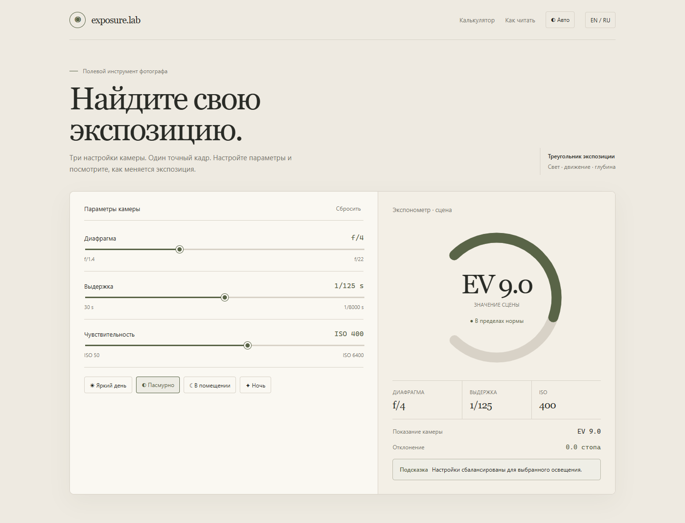
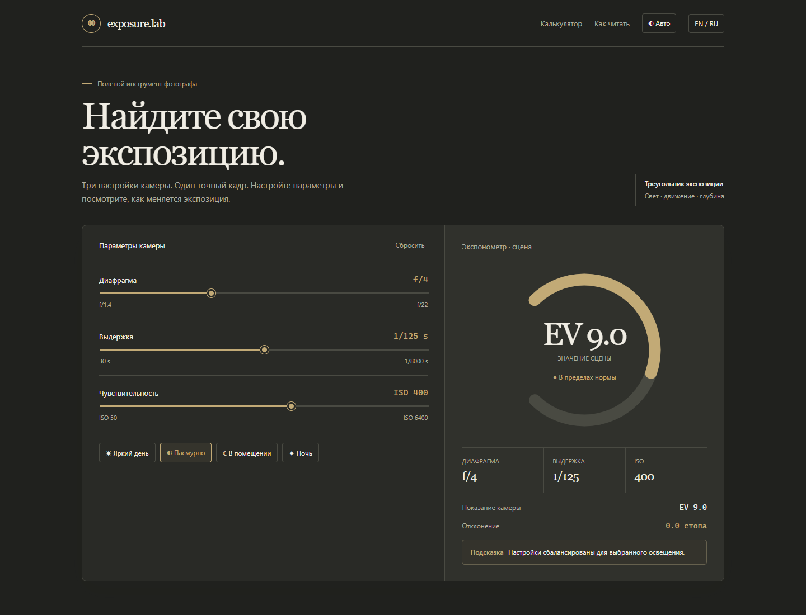

# Exposure Lab

An interactive, browser-based exposure calculator for photographers. Adjust aperture, shutter speed and ISO, choose a lighting preset, and compare the camera reading with the scene.

## Features

- Responsive Russian and English interface
- Automatic theme follows the device setting; light and dark modes can be selected and remembered
- Live exposure value and stop-difference readout
- Lighting presets for daylight, overcast, indoor and night scenes
- No account, server or build step required
- Search metadata, social preview tags and structured data are included

## Run locally

Open `index.html` in a modern browser. The calculator runs locally; Google Fonts are an optional remote enhancement and system fonts are used as fallbacks.

## Project image

## SEO and location

The page has language, canonical, alternate-language, Open Graph and WebApplication structured-data metadata. Replace the `example.com` URLs with the deployed domain before release. The project is location-neutral; add city or regional targeting only when a target market is chosen.

## License

MIT

---

# Exposure Lab (RU)

Интерактивный калькулятор экспозиции для фотографов. Меняйте диафрагму, выдержку и ISO, выбирайте пресет освещения и сравнивайте показание камеры со сценой.

## Возможности

- Адаптивный интерфейс на русском и английском
- Автотема следует настройке устройства; светлый и тёмный режимы можно выбрать и сохранить
- Расчёт экспозиционного числа и отклонения в стопах в реальном времени
- Пресеты для ясного дня, пасмурной погоды, помещения и ночи
- Не требует регистрации, сервера или сборки
- Добавлены поисковые метаданные, разметка для соцсетей и структурированные данные

## Запуск

Откройте `index.html` в современном браузере. Калькулятор работает локально; Google Fonts — необязательное улучшение, предусмотрены системные запасные шрифты.

## Фото проекта

## SEO и география

Добавлены языковые, canonical, hreflang, Open Graph и WebApplication метаданные. Перед публикацией замените адреса `example.com` на домен проекта. Проект не привязан к конкретному городу; региональное SEO можно добавить после выбора целевого рынка.

## Лицензия

MIT
